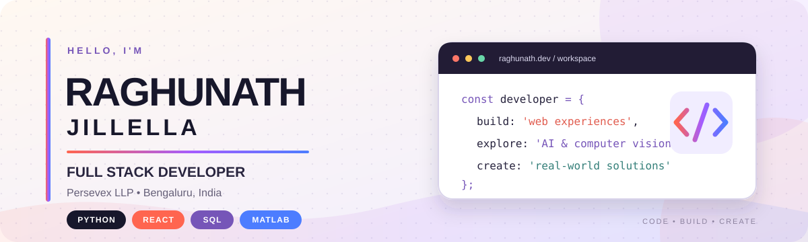

<!-- ===================== HERO ===================== -->

 

---

## ✦ At a Glance

| 💼 Current Role | 📍 Location | 🎓 Education | ⚡ Interests |
|:--|:--|:--|:--|
| Full Stack Developer · Persevex LLP | Bengaluru, India | B.Tech ECE · KARE · 2026 | Full Stack · AI/ML · IoT · Automation |

## 👋 About Me

I'm a Full Stack Developer at **Persevex LLP**, with a B.Tech background in Electronics and Communication Engineering. I enjoy building practical applications that combine clean user interfaces, reliable backend systems and useful automation.

My project experience includes web application development, Python, database integration, MATLAB image processing and computer vision. I’m continuously improving my skills by building and documenting practical projects.

## 🧰 Tech Stack

**Languages**

  

**Frontend**

  

**Backend, Databases & Tools**

  

**Other areas:** SQL · MATLAB · OpenCV · Arduino · AI/ML · Computer Vision · IoT

## 🚀 Featured Projects

<table>
  <tr>
    <td width="50%" valign="top">
      <h3>⚡ Persevex WorkSync</h3>
      Workforce and attendance-oriented web application. The repository is private, so source code is not publicly accessible.
        
      Next.js · React · TypeScript · Prisma · Supabase
        
      <a href="https://github.com/JILLELLARAGHUNATH/Persevex-Worksync">Private repository</a>
    </td>
    <td width="50%" valign="top">
      <h3>🏥 Hospital Scheduler</h3>
      Frontend scheduling application with doctor filters, calendar views and appointment categories.
        
      Next.js · TypeScript
        
      <a href="https://github.com/JILLELLARAGHUNATH/Hospital-Scheduler">View repository</a>
    </td>
  </tr>
  <tr>
    <td width="50%" valign="top">
      <h3>🎓 Student Management System</h3>
      Student record management application with CRUD operations and a simple browser interface.
        
      Python · SQLite
        
      <a href="https://github.com/JILLELLARAGHUNATH/Student-Management-System-">View repository</a>
    </td>
    <td width="50%" valign="top">
      <h3>🌿 Weed Detection</h3>
      MATLAB image-processing workflow for crop weed detection using segmentation and image-processing operations.
        
      MATLAB · Image Processing
        
      <a href="https://github.com/JILLELLARAGHUNATH/weed-detection">View repository</a>
    </td>
  </tr>
  <tr>
    <td width="50%" valign="top">
      <h3>🌐 Developer Portfolio</h3>
      Personal portfolio showcasing my development background and projects.
        
      React · Vite · TypeScript
        
      <a href="https://raghunath-jillella.vercel.app/">Live portfolio</a> · <a href="https://github.com/JILLELLARAGHUNATH/Portfolio">Source code</a>
    </td>
    <td width="50%" valign="top">
      <h3>🧮 Tkinter Calculator</h3>
      Desktop calculator with a Python Tkinter interface and basic arithmetic operations.
        
      Python · Tkinter
        
      <a href="https://github.com/JILLELLARAGHUNATH/Calculator-using-Tkinter">View repository</a>
    </td>
  </tr>
</table>

## 💼 Experience

**Full Stack Developer · Persevex LLP**  
Working on web application development, frontend interfaces, backend functionality, database integration and maintenance.

**MATLAB Image Processing Intern · Youngminds Technology Solutions Pvt. Ltd.**  
*May 2024 – July 2024*  
Worked on agricultural weed detection using image preprocessing, segmentation, morphological operations and region visualization.

## 📊 GitHub Statistics

  
  

  

## 🎓 Education

**B.Tech · Electronics and Communication Engineering**  
Kalasalingam Academy of Research and Education · 2022–2026

## 🌱 Currently Exploring

Full stack architecture · AI/ML applications · Computer Vision · IoT projects · Cloud technologies · Open-source contributions

---

### ✨ Code · Build · Learn · Grow · Repeat

*Turning ideas into useful software through curiosity, engineering and continuous learning.*

<a href="https://www.linkedin.com/in/raghunath-jillella-a69555268/">LinkedIn</a> ·
<a href="mailto:jillellaraghunath@gmail.com">Email</a> ·
<a href="https://raghunath-jillella.vercel.app/">Portfolio</a>

