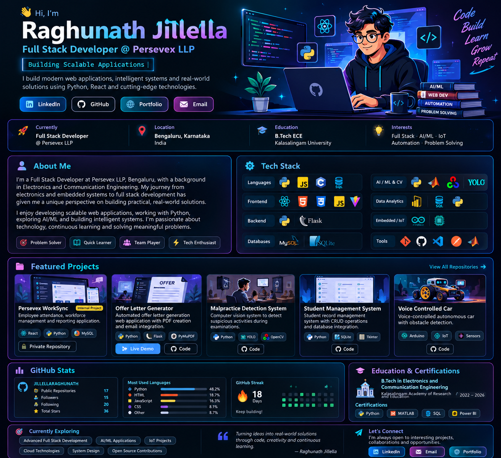

# Jillella Raghunath

---

## About Me

I'm a Full Stack Developer at **Persevex LLP**, with a B.Tech background in Electronics and Communication Engineering. I build practical web applications and explore Python, AI/ML, computer vision, IoT and automation.

## Tech Stack

  

## Featured Projects

| Project | Description | Technologies |
|:--|:--|:--|
| [Persevex WorkSync](https://github.com/JILLELLARAGHUNATH/Persevex-Worksync) | Workforce and attendance web application *(private repository)* | Next.js, TypeScript |
| [Hospital Scheduler](https://github.com/JILLELLARAGHUNATH/Hospital-Scheduler) | Doctor availability and appointment scheduling | Next.js, TypeScript |
| [Student Management System](https://github.com/JILLELLARAGHUNATH/Student-Management-System-) | Student record management with CRUD operations | Python, SQLite |
| [Weed Detection](https://github.com/JILLELLARAGHUNATH/weed-detection) | MATLAB-based crop weed detection using image processing | MATLAB |
| [Developer Portfolio](https://raghunath-jillella.vercel.app/) | Personal portfolio and project showcase | React, Vite |
| [Tkinter Calculator](https://github.com/JILLELLARAGHUNATH/Calculator-using-Tkinter) | Desktop calculator application | Python, Tkinter |

## Experience

**Full Stack Developer — Persevex LLP**  
Web application development, frontend interfaces, backend functionality and database integration.

**MATLAB Image Processing Intern — Youngminds Technology Solutions Pvt. Ltd.**  
May 2024 – July 2024 · Image preprocessing, segmentation, morphological operations and weed detection.

## Education

**B.Tech — Electronics and Communication Engineering**  
Kalasalingam Academy of Research and Education · 2026

---

### Code · Build · Learn · Grow · Repeat

[LinkedIn](https://www.linkedin.com/in/raghunath-jillella-a69555268/) · [Email](mailto:jillellaraghunath@gmail.com) · [Portfolio](https://raghunath-jillella.vercel.app/)

